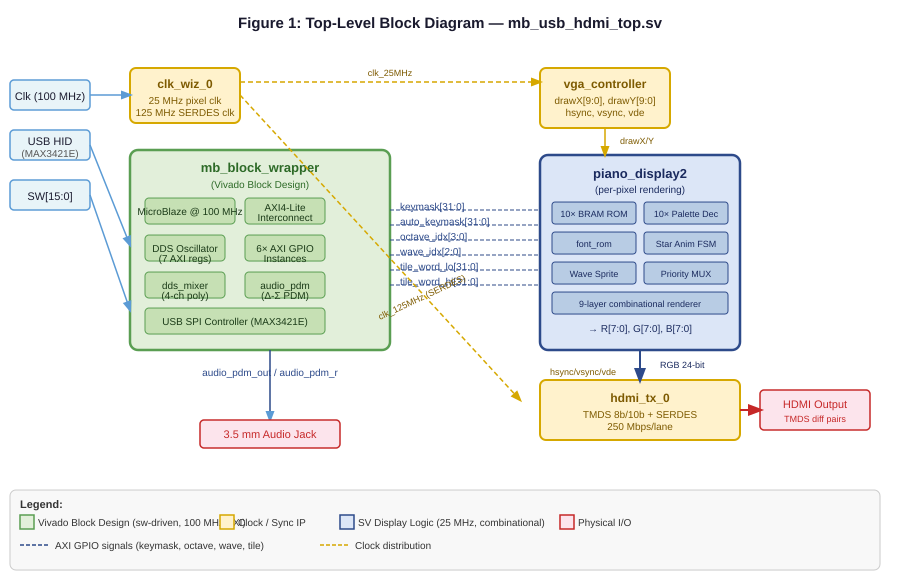

# Falling Fish

### FPGA Polyphonic Synthesizer & Rhythm Game

**Selected for the ECE 385 Course Showcase · Spring 2026 · University of Illinois Urbana-Champaign**

Falling Fish combines a playable digital piano, an autoplay music library, and a four-lane rhythm game on an Urbana FPGA board. A USB keyboard controls the system while the FPGA generates audio and renders the interface over HDMI.

Developed jointly by **Yueyao Wang and Sihan Yi**.

**[Watch the course showcase demo →](https://www.youtube.com/watch?v=iHTvJDg6JQU&t=4041s)** — opens at **1:07:21**.  
**[Read the final project report →](docs/final-report.pdf)**

## Features

- **Digital piano:** four-voice polyphony, six selectable waveform modes, octave shifting, and volume control.
- **Autoplay:** an eight-song library with synchronized piano-key highlighting.
- **Rhythm game:** three songs, falling fish tiles, hold notes, timing judgments, scores, combos, and an infinite mode.
- **Interactive graphics:** song selection, countdown, pause and result screens, and animated star ratings.

## Hardware–Software Architecture

The system uses a **Spartan-7 XC7S50 FPGA** with a **MicroBlaze soft-core processor**.

The C firmware handles USB keyboard input, song scheduling, game rules, scoring, and state transitions. SystemVerilog modules handle DDS audio synthesis, four-channel mixing, PDM audio output, HDMI timing, and sprite rendering. AXI4-Lite registers and AXI GPIO connect these subsystems.

### Audio synthesis

Four DDS oscillators generate simultaneous notes. Their outputs are mixed, scaled by a master-volume control, and converted to a one-bit PDM stream for audio output.

### Graphics pipeline

The display renders a 640 × 480 active area using a 25 MHz pixel clock. Palette-indexed sprite ROMs and coordinate-based rendering combine the background, piano keys, falling tiles, text, and animations without a full framebuffer.

Sprite images are converted into COE initialization data and paired SystemVerilog palette modules, then integrated into Vivado Block Memory Generator IP.

### Synchronization and game state

The firmware sends packed game-state and tile data to the rendering hardware. Display logic decodes these fields to draw the interface, while frame-based counters drive animations.

## Documentation

- [Final report](docs/final-report.pdf)
- [HDMI pipeline](docs/diagrams/hdmi-pipeline.svg)
- [Audio pipeline](docs/diagrams/audio-pipeline.svg)
- [Game state machine](docs/diagrams/game-state-machine.svg)
- [Star animation state machine](docs/diagrams/star-animation.svg)
- [Final source locations](docs/source-guide.md)
- [Image conversion workflow](tools/image_to_coe/README.md)
- [Archived sprite inputs](assets/sprites/README.md)

## Source Guide

The repository contains several development iterations. The archived final implementation is located at:

| Component | Path |
| --- | --- |
| Vivado project | `synthesizer/synthesizer.xpr` |
| Top-level hardware | `synthesizer/synthesizer.srcs/sources_1/imports/hdl/mb_usb_hdmi_top.sv` |
| Display renderer | `synthesizer/synthesizer.srcs/sources_1/imports/hdl/piano_display2.sv` |
| Application firmware | `synthesizer/workspace/synthesizer/src/main_piano_usb_hdmi.c` |
| Custom audio IP | `ip_repo/dds_pdm_1_0/` |
| Graphics assets | `src/coe/` |

## Project Status and Limitations

The project was demonstrated in ECE 385 and selected for the course showcase. The archived final code is preserved in commit `a28930b` (`final`). A clean rebuild of the archived project has not yet been revalidated.

SD-card song loading was explored but was not successfully integrated into the final demonstration. Songs are compiled into the firmware. Best scores are stored for the current run and are not preserved across power cycles.

## Acknowledgments

Developed for ECE 385 at the University of Illinois Urbana-Champaign.

The image conversion workflow uses [Image_to_COE](https://github.com/amsheth/Image_to_COE), whose upstream README credits Arnav Sheth and Ian Dailis. The archived scripts and original attribution are preserved under `tools/image_to_coe/`. See [third-party notices](THIRD_PARTY_NOTICES.md) for the outstanding redistribution-terms check.

